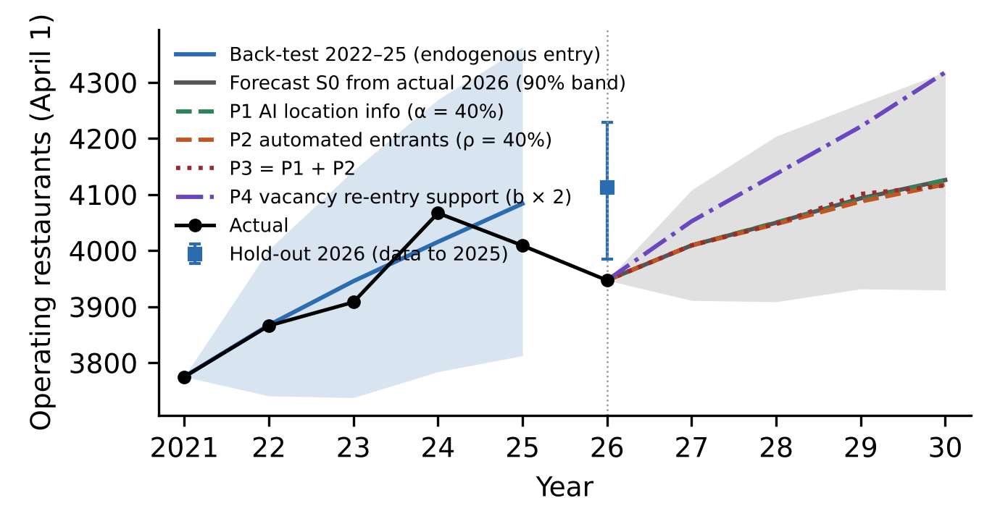

# 성동구 음식점 폐업 위험: 경쟁 네트워크 · Cox · System Dynamics

서울시 성동구 일반음식점이 **주변에 어떤 가게가 얼마나 있을 때 더 빨리 문을 닫는지**를 생존분석(Cox)으로 추정하고,
그 위험 함수를 점포 수 시뮬레이션(System Dynamics, SD)에 넣어 **AI 입지 정보 활용과 무인·자동화 점포(피지컬 AI) 확산이 폐업을 어떻게 바꾸는지**를 시나리오로 비교한 연구의 코드·데이터·결과입니다.

- 논문: 「경쟁 네트워크 구조를 반영한 서울시 성동구 음식점 폐업 위험 분석과 입지 정보 활용 시나리오 시뮬레이션」, 김은혜\*·오은준\*·오주희\*\* (\*공동 제1저자, \*\*교신저자), 2026 한국정보기술학회 추계 종합학술대회
- 실행 환경: Python 3.9 이상, `pip install -r requirements.txt`

## 목차

1. [한눈에 보기](#한눈에-보기)
2. [논문 표·그림과 코드·결과 파일](#논문-표그림과-코드결과-파일)
3. [연구 설계](#연구-설계)
4. [주요 결과](#주요-결과)
5. [실행 방법](#실행-방법)
6. [폴더 구성](#폴더-구성)
7. [변수 설명](#변수-설명)
8. [데이터 출처](#데이터-출처)
9. [한계와 참고](#한계와-참고)

## 한눈에 보기

| 분석 | 내용 | 표본 | 코드 | 결과 |
|---|---|---|---|---|
| ① 기준 Cox | 2021-04-01 영업 점포를 2026-10-13까지 추적. 반경 100~500m 경쟁·집적·네트워크 구조와 폐업 위험 | 3,775곳 (Cox는 매출 결측 제외 2,967곳) | 1~4단계 | `outputs/results_summary.md`, `outputs/tables/`, `outputs/figures/` |
| ② 연도별 Cox | 기준일 2021~2025년 4월 1일 코호트 5개에 같은 모형 적용 | 3,775~4,067곳 × 5 | 6~7단계 | `outputs/yearly/yearly_cox_summary.csv` |
| ③ SD 시뮬레이션 | 점포-연 폐업 확률 → 점포 수 stock-flow. 실제 신규 점포를 넣은 2021→2025 검증과 정보 활용률(α) 시나리오 | 점포-연 19,625건 | 8단계 | `outputs/yearly/` |
| ④ 피지컬 AI 시나리오 | ③에서 신규 점포 중 비율 ρ를 자동화형으로 두고 주변 집적 효과를 λ만큼 줄인 반사실 시나리오 | ③과 같음 | 10단계 | `outputs/physical_ai/` |
| ⑤ 피드백 확장 SD | 공실 재진입 고리로 진입을 내생화하고, 판별 검증(2026년 홀드아웃 포함)과 2027~2030 정책 예측 | ③ + 4월 기준 17개 동 패널(2016~2026) | 12~14단계 | `outputs/sd_feedback/` |

핵심 결과
- **집적(전체 음식점 수)은 일관되게 폐업 위험을 낮춥니다.** 100m 안 음식점이 10곳 많을수록 위험 7.9% 감소(HR 0.921, 모형 B). 네 반경 모두와 100m의 5개 기준일 모두에서 유의하고, 동 고정효과를 넣어도 유지됩니다.
- **동종 경쟁(같은 업태 수)은 본 분석에서 유의하지 않고**, 2023·2024년 코호트와 같은 동 안의 비교에서만 약하게 위험을 높입니다.
- **네트워크 지표의 추가 설명력은 100·200m 가중 연결강도에 한정**됩니다(C-index 개선 0.003).
- **진입을 내생화한 SD는 2022~2025년 점포 수를 −1.3~+1.9%로 재현**해 단순 모형(−5.5~−1.7%)보다 정확하지만, 점포 단위 판별력은 낮고(AUC 0.56~0.62) 2026년 진입 급감은 예측하지 못합니다.
- **AI 입지 정보**는 과거 반사실에서 누적 폐업을 3.5%(α = 40%) 줄이지만, 신규 점포의 40%가 자동화형이면 그 순효과가 약 3분의 1 줄고, 공실 수용 한도를 둔 2030년 예측에서는 0.5%로 작아집니다.

## 논문 표·그림과 코드·결과 파일

| 논문 | 내용 | 결과 파일 | 코드 |
|---|---|---|---|
| 그림 1 | 연구 모형과 SD 인과 고리(R1·B1·B2) | `outputs/paper/fig1_research_model.png` (원본 `fig1_research_model.html`) | — |
| 표 1 | 반경별 경쟁 변수 HR | `outputs/tables/cox_radius_models.csv` | 4단계 |
| 표 2 | 경쟁 네트워크 지표 HR, 우도비 검정 | `outputs/tables/cox_network_models.csv` | 4단계 |
| 3.1절 본문 | Kaplan-Meier, 시간가변 계수, 강건성 | `outputs/tables/km_by_adjacent_biz_200m.csv`, `cox_time_varying_r.csv`, `cox_robustness_300m.csv` | 4단계 |
| 3.2절 본문 | 기준일별 100m HR | `outputs/yearly/yearly_cox_summary.csv` | 7단계 |
| 2.4절 식 (3)~(5) | SD 폐업 확률 계수 | `outputs/yearly/sd_params.csv`, `sd_run_log.txt` | 8단계 |
| 2.4절 식 (6) | 공실 재진입 진입식 | `outputs/sd_feedback/dong_panel_april.csv` (추정치는 12단계 실행 출력) | 12단계 |
| 표 3, 3.3절 | SD 판별 검증, 동 고정효과 | `outputs/sd_feedback/val_summary.csv`, `val_auc.csv`, `fe_coef.csv`, `val_log.txt` | 13단계 |
| 3.4절 본문 | 정보 활용 시나리오(2021~2025) | `outputs/yearly/sd_run_log.txt`, `sd_scenarios.csv` | 8단계 |
| 표 4, 3.5절 | 피지컬 AI 시나리오 | `outputs/physical_ai/pai_summary.csv` | 10단계 |
| 그림 2, 3.6절 | 검증 궤적과 2027~2030 정책 예측 | `outputs/sd_feedback/fig_validation_forecast.png`, `fc_summary.csv` | 13·14단계 |

## 연구 설계

- **기준 집단**: 2021-04-01 영업 중인 성동구 일반음식점 **3,775개**
- **관찰 기간**: 2021-04-01 ~ 2026-10-13(인허가 데이터 추출일), 폐업 **1,677개(44.4%)**, 나머지는 우측 중도절단
- **Cox 분석 표본(①)**: 상권 매출이 결측인 808곳(업종 미분류 780곳 포함)을 제외한 **2,967개**(폐업 1,267개)
- **연도별 코호트(②~⑤)**: 2021~2025년 매년 4월 1일 기준 3,775 / 3,866 / 3,908 / 4,067 / 4,009곳, 같은 종료일까지 추적
- **연구 질문**
  - RQ1. 반경 기반 경쟁 변수를 통제한 뒤에도 경쟁 네트워크 구조가 폐업 위험을 추가로 설명하는가?
  - RQ2. 경쟁 효과는 반경과 관찰 기준일에 따라 어떻게 달라지는가?
  - RQ3. 위험 함수와 진입 피드백을 넣은 SD 모형은 과거와 2026년을 얼마나 재현하며, AI 입지 정보와 피지컬 AI 확산은 2030년까지 폐업을 어떻게 바꾸는가?
- **가설**
  - H1 (동종 경쟁): 같은 업태 이웃 수(C)와 비율(R)이 클수록 폐업 위험이 높다.
  - H2 (집적): 전체 음식점 수(BIZ)가 클수록 폐업 위험이 낮다.
  - H3 (공간 범위): H1·H2의 효과는 반경이 작을수록 크다.
  - H4 (네트워크): 반경 변수를 통제한 뒤에도 네트워크 지표가 폐업 위험을 추가로 설명한다.

## 주요 결과

### ① 기준 Cox (1~4단계)

통제 변수는 업력, 임대료 수준(low/mid/high), 상권 점포당 매출(log), 업태이고, 상권 단위 군집 강건 표준오차(72개 군집)를 썼습니다. 전체 수치는 [`outputs/results_summary.md`](outputs/results_summary.md)에 있습니다.

| 가설 | 결과 | 근거 |
|---|---|---|
| H1 동종 경쟁 | 기각 | C·R 모두 네 반경에서 5% 수준으로 유의하지 않음 |
| H2 집적 | 지지 | 100m 안 음식점 10곳당 HR 0.921(모형 B, 95% CI 0.899–0.944) |
| H3 공간 범위 | 부분 지지 | 표준편차 1당 BIZ의 HR이 100·200m 0.77·0.76 → 500m 0.84 |
| H4 네트워크 | 제한적 지지 | 100m(LR χ²(3) = 18.2, p < .001)·200m(10.0, p = .019)에서만 유의, 가중 연결강도만 위험 증가(1 SD당 HR 1.31, 1.17). 연결강도는 사실상 거리 가중 동종 밀도(C와 VIF 5~7), C-index 개선 0.003 |

- 반경 200m 음식점 수 상위 1/3 집단의 생존율은 64.6%로 하위 1/3(49.2%)보다 15.4%p 높습니다(log-rank p < .001).
- 결론은 임대료 처리 방식, 매출 변수 제외(전체 3,775곳), 밀집 상위 5% 제외, 일괄 폐업일 제외, 표준오차 보정 방식에 관계없이 유지됩니다(300m BIZ HR 0.967~0.978).
- Competitor_R의 비례위험 위반 신호(p = .013–.032)는 1년 구간별 시간가변 계수로 보완했고 결론은 같습니다(Wald p = .054–.219).

<p align="center">
  
  
</p>

### ② 연도별 Cox (6~7단계)

반경 100m, 10곳당 HR. 통제 변수는 업력·임대료 수준·업태이고 추정매출은 쓰지 않습니다(전체 점포 사용, ①의 '매출 변수 제외' 설정과 같음).

| 기준일 | 점포 | 폐업 | 동종 C HR (p) | 전체 BIZ HR (p) | 네트워크 추가 LR p |
|---|---|---|---|---|---|
| 2021-04-01 | 3,775 | 1,677 | 0.986 (.714) | 0.932 (<.001) | .013 |
| 2022-04-01 | 3,866 | 1,535 | 1.024 (.583) | 0.930 (<.001) | .332 |
| 2023-04-01 | 3,908 | 1,269 | 1.100 (.034) | 0.922 (<.001) | .351 |
| 2024-04-01 | 4,067 | 1,066 | 1.128 (.049) | 0.915 (<.001) | .536 |
| 2025-04-01 | 4,009 | 660 | 1.105 (.123) | 0.943 (.004) | .452 |

코호트들이 같은 점포를 공유하고 2025년 코호트는 추적이 약 1.5년이라, C의 변화를 시간 추세로 단정할 수는 없습니다.

### ③ SD 시뮬레이션 (8단계)

```
S(t+1) = S(t) − D(t) + E(t)                         S: 영업 점포 수, D: 폐업, E: 신규
D(t)   = Σ pᵢ(t),  pᵢ(t) = 1 − exp(−exp(ηᵢ(t)))    점포별 1년 폐업 확률 (비례위험의 이산시간 형태)
ηᵢ(t)  = a + θ'Zᵢ + β_C·C₂₀₀(t)/10 + β_B·BIZ₂₀₀(t)/10
```

- C₂₀₀·BIZ₂₀₀은 그해 영업 점포로 매년 다시 세므로 폐업이 밀도를 낮춰 다음 해 위험을 높입니다(R1 집적 고리).
- 계수(점포-연 19,625건): BIZ₂₀₀ 10곳당 HR 0.969(p < .001), C₂₀₀ 1.026(p = .07). 회차마다 계수를 추정 분포에서 뽑아 200회 반복합니다.
- 실제 신규 점포를 넣으면 2022~2025년 점포 수 오차는 −1.7~+0.4%로, 평균 폐업률만 쓰는 단순 모형(−2.3~+0.7%)과 구별되지 않습니다. 이 한계는 ⑤에서 진입을 내생화해 보완했습니다.

정보 활용률 시나리오: 정보를 받은 신규 점포(비율 α)는 무작위 후보지 5곳과 원래 입지 중 예상 폐업 확률이 가장 낮은 곳을 고릅니다.

| α | 누적 폐업 2021→2025 (5~95%) | S0 대비 | 신규 점포 주변 200m 음식점 수 |
|---|---|---|---|
| 0% (S0) | 1,786 (1,713~1,863) | — | 93 |
| 40% | 1,724 (1,654~1,791) | −62 (−3.5%) | 145 |
| 60% | 1,689 (1,624~1,754) | −97 (−5.4%) | 183 |

정보를 받은 점포는 집적 효과가 큰 밀집지로 이동합니다. 혼잡과 수용 한도가 없어 낙관적인 값입니다.

### ④ 피지컬 AI 대체 시나리오 (10단계, 논문 표 4)

```
P(신규 점포 i가 자동화형) = min(1, ρ · w_업종 / 그해 신규 점포 평균 w)
BIZ*ᵢ(t) = BIZ₂₀₀ᵢ(t) − λ · (반경 200m 안 자동화형 점포 수)        ← ③의 위험식에서 BIZ₂₀₀ 대신 사용
```

- 업종 가중치 w: 리뷰 34,736건에서 구한 업종별 비대면 주문·포장·배달 언급률(`data/interim/category_automation_rates.csv`)을 전체 평균으로 나눈 값입니다.
- λ는 자료로 식별되지 않아(이웃의 자동화 성향 합과 BIZ₂₀₀의 상관 0.999) 0.5를 기준, 1.0을 민감도로 둡니다. ρ·λ는 가정입니다.

| ρ | λ | 자동화형(2025) | 누적 폐업 변화 (5~95%) | 밀집지 / 그 외 | α = 40% 순효과 |
|---|---|---|---|---|---|
| 0% | — | 0 | 기준 (1,786) | — | −62 |
| 20% | 0.5 | 263 | +8 (+3~+13) | +4 / +4 | −51 |
| 40% | 0.5 | 526 | +16 (+8~+25) | +8 / +8 | −40 |
| 20% | 1.0 | 263 | +16 (+8~+26) | +8 / +8 | — |
| 40% | 1.0 | 525 | +32 (+19~+46) | +16 / +16 | — |

정보가 있을 때 ρ = 40%의 추가 폐업은 16곳에서 22곳으로 늘고 밀집지(8 → 17곳)에 몰립니다. 정보를 받은 점포가 몰리는 밀집지에서 자동화형이 집적 이익을 잠식하기 때문입니다.

### ⑤ 피드백 확장 SD · 판별 검증 · 2030 예측 (12~14단계, 논문 표 3, 그림 2)

```
고리  R1 집적        폐업 → BIZ₂₀₀↓ → 다음 해 폐업 확률↑
      B1 유출        점포 수↑ → 폐업↑ → 점포 수↓
      B2 공실 재진입 폐업 → 공실 → 신규 진입(공실에 입점) → BIZ↑ → 위험↓
진입식  E_k(t) ~ Poisson(μ_k),  ln μ_k = a_k + τ + b·ln(D_k(t)+1)    (동 k, 그해 폐업 D_k)
```

- 진입식은 4월 기준 17개 동 패널(2016~2026)의 동·연도 고정효과 Poisson으로 추정합니다. 폐업에 대한 진입 탄력성 b = 0.26(p = .002, 2021년까지 학습). τ와 연도 충격은 최근 5개 연도 효과의 평균과 표준편차입니다.
- 예측의 정보 시나리오에서는 정보를 받은 점포가 빈 공실 5곳과 현재 입지 중에서 고르고, 공실 하나에 한 점포만 들어갑니다.

판별 검증 (`val_summary.csv`, 100회)

| 지표 | 결합 모형 | 단순 모형 | 기준 |
|---|---|---|---|
| 2022~25 점포 수 오차 (진입 내생) | −1.3~+1.9% | −5.5~−1.7% | — |
| 2025 동별 점포 수 가중 절대오차 | 8.7% | 10.2% | 12.6% (변화 없음) |
| 동별 폐업률 상관 (2022~25) | 0.57 | −0.27 | 0.81 (동의 2016~21 폐업률) |
| 　동 고정효과 포함 (학습 기간 안) | 0.97 | — | — |
| 점포 단위 시간 밖 AUC | 0.56~0.62 | 0.59~0.61 (업력만) | 0.50 |
| 2026 홀드아웃 점포 수 오차 | +4.2% | +3.1% | +1.6% (변화 없음) |
| 　실제 2026 진입 투입 | +0.7% | +0.5% | +1.6% |

- 동 고정효과를 넣어도 BIZ₂₀₀ 효과는 유지되고(10곳당 HR 0.965), 같은 동 안에서는 C₂₀₀도 약하게 위험을 높입니다(1.031, p = .040).
- 2026년 과대 예측의 원인은 진입 급감(실제 411곳, 2016년 이후 최저)입니다. 실제 진입을 넣으면 실제 3,947곳이 90% 구간(3,931~4,004) 안에 들어옵니다.

2027~2030 정책 예측 (`fc_summary.csv`, 2026-04-01 실제 3,947곳에서 출발, 100회)

| 시나리오 | 2030 점포 수 (90% 구간) | 4년 누적 폐업 | 기준 대비 폐업 (5~95%) |
|---|---|---|---|
| S0 기준 | 4,126 (3,930~4,319) | 1,799 | — |
| P1 AI 입지 정보 α = 40% (빈 공실 후보) | 4,126 | 1,790 | −8 (−33~+15), −0.5% |
| P2 자동화형 ρ = 40%, λ = 0.5 | 4,118 | 1,815 | +16 (−10~+36), +0.9% |
| P3 = P1 + P2 | 4,116 | 1,811 | +12 (−15~+36), +0.7% |
| P4 공실 재입점 지원 (b × 2) | 4,318 | 1,832 | +34 (−19~+91); 점포 +192 (−101~+519) |

<p align="center"></p>

## 실행 방법

프로젝트 폴더에서 번호 순서대로 실행합니다. 각 스크립트는 파일 위치를 기준으로 경로를 찾으므로 어느 폴더에서 실행해도 됩니다. 난수 시드가 고정되어 있어 같은 결과가 나옵니다.

```bash
pip install -r requirements.txt

# ① 기준 Cox
python code/01_preprocess.py        # 원자료 → data/interim/final_restaurant_level_dataset.csv  (약 1분)
python code/02_attach_reviews.py    # + 리뷰 요약 변수 → data/interim/restaurants_with_reviews_raw.csv
python code/03_build_features.py    # + 경쟁·네트워크 변수 → data/final_dataset_with_reviews.csv
python code/04_cox_analysis.py      # 생존분석 → outputs/results_summary.md, tables/, figures/

# ② 연도별 Cox · ③ SD
python code/06_yearly_cohorts.py    # 코호트 5개 → data/yearly/  (약 1분)
python code/07_yearly_cox.py        # → outputs/yearly/yearly_cox_summary.csv  (약 2분)
python code/08_sd_simulation.py all > outputs/yearly/sd_run_log.txt   # 계수·검증·정보 시나리오 (40분 이상)

# ④ 피지컬 AI 시나리오
python code/10_sd_physical_ai.py check   # ρ = 0 결과가 8단계와 같은지 확인 (1분)
python code/10_sd_physical_ai.py         # 8개 조합 × 200회 → outputs/physical_ai/ (2코어 약 1시간 30분)
python code/10_sd_physical_ai.py fig     # 그림

# ⑤ 피드백 확장 SD · 판별 검증 · 2030 예측
python code/12_sd_feedback_model.py      # 4월 기준 동 패널 + 진입식 추정치 (수 초)
python code/13_sd_validation.py          # 판별 검증 9개 사례 × 100회 (2코어 약 5분)
python code/14_sd_forecast.py            # 2027~2030 시나리오 5개 × 100회 + 그림 2 (2코어 약 40분)
```

정상 실행 확인

| 단계 | 출력 |
|---|---|
| 1 | `최종 데이터 shape: (3775, 33)` |
| 2 | `리뷰 매칭 1,395개 (37.0%)` |
| 4 | `Cox 표본 2,967개 (매출 결측 808곳 제외, 폐업 1,267건, 군집 72개)` |
| 6 | 2021 코호트 검증 항목이 모두 `일치 100.00%`, 코호트별 `n=3775, 폐업 1677` … `n=4009, 폐업 660` |
| 8 | `[추정] 점포-연 19625건, 폐업 2238건 \| C200 10곳당 HR 1.026 (p=0.072), BIZ200 10곳당 HR 0.969 ...` |
| 10 | `check`에서 `8단계와 폐업 수 일치 100%` |
| 12 | `[진입식, 2021년 전이까지 학습] b = 0.260 (SE 0.085, p = 0.0021) ...` |

- 1단계의 좌표 결측 점포는 `data/interim/geocode_cache.csv`(Kakao 지오코딩 결과)로 채우므로 API 키 없이 실행됩니다. 캐시에 없는 9곳(지오코딩 실패)은 좌표 결측으로 제외됩니다.
- `code/01_preprocess.py`의 `PAPER_VERSION = True`가 논문의 전처리 설정입니다(5개 업태 미분류, 상권 밖 점포 매출 보간).
- 빠르게 확인만 하려면 `NREP=20`을 붙여 실행합니다(시뮬레이션 수치는 달라짐).
- 7·8단계는 `NOSALES=0`으로 추정매출 포함 사양(민감도)을 실행할 수 있습니다.

## 폴더 구성

```
code/
  01_preprocess.py           1단계: 인허가·상권·매출·임대료 원자료 → 점포 단위 데이터
  02_attach_reviews.py       2단계: 네이버 리뷰 요약 변수 결합
  03_build_features.py       3단계: 임대료 범주, 반경 경쟁 변수, 경쟁 네트워크 변수
  04_cox_analysis.py         4단계: Kaplan-Meier, Cox 모형(반경·네트워크), 강건성 검토 (논문 표 1·2)
  06_yearly_cohorts.py       6단계: 기준일 2021~2025 코호트 5개 구축
  07_yearly_cox.py           7단계: 코호트별 Cox
  yearly_cox_spec.py         7단계가 쓰는 Cox 모형 함수
  08_sd_simulation.py        8단계: SD 계수 추정·검증·정보 활용률 시나리오
  10_sd_physical_ai.py       10단계: 피지컬 AI 대체 시나리오 (논문 표 4)
  12_sd_feedback_model.py    12단계: 공실 재진입 고리(내생 진입)를 더한 SD 모형 함수, 4월 기준 동 패널
  13_sd_validation.py        13단계: 판별 검증, 2026 홀드아웃, 동 고정효과 (논문 표 3)
  14_sd_forecast.py          14단계: 2027~2030 정책 시나리오 예측 (논문 그림 2)
  review_collection/         네이버 리뷰 수집 과정 기록 (분석 실행에는 필요 없음)
data/
  raw/                       원자료 (대부분 zip, 코드가 그대로 읽음)
    서울시 성동구 일반음식점 인허가 정보.csv          1단계용, 2026-10-13 추출
    성동구_일반음식점_인허가_갱신_20261019.csv        6·12단계용, 2026-10-19 내려받음
    성동구_음식점_업태_서울상권서비스업종_매핑.csv     업태 → 서울시 서비스 업종 매핑
    서울시 상권분석서비스(영역-상권).shp 외           상권 경계
    서울시_상권분석서비스(점포-상권)_2021~2025년      점포 수
    서울시_상권분석서비스(추정매출-상권)_2021~2025년  추정매출
    서울특별시_성동구 상가임대료 정보_20211201.csv     임대료
  interim/
    geocode_cache.csv                   Kakao 지오코딩 결과 (1단계 입력)
    geocode_vworld_full.csv, _pilot.csv VWorld 지오코딩 결과, 2022~2025 새 점포 좌표 (6단계 입력)
    review_features.csv                 리뷰 요약 변수, 1,395개 점포 (2단계 입력)
    category_automation_rates.csv       업종별 비대면 주문·포장·배달 리뷰 언급률 (10·12단계 입력)
    final_restaurant_level_dataset.csv  1단계 결과
    restaurants_with_reviews_raw.csv    2단계 결과
  final_dataset_with_reviews.csv        3단계 결과: 분석용 최종 데이터 (3,775행)
  yearly/cohort_{2021~2025}_end20261013.csv   6단계 결과: 연도별 코호트
outputs/
  results_summary.md         ① 결과 요약
  tables/  figures/          ① 표·그림
  yearly/                    ②③ 결과 (Cox 요약, SD 계수·검증·시나리오, 실행 로그)
  physical_ai/               ④ 결과
  sd_feedback/               ⑤ 결과 (검증·예측·그림 2·실행 로그)
  paper/                     논문 그림 1
requirements.txt
```

## 변수 설명

`data/final_dataset_with_reviews.csv` 기준이며, `data/yearly/cohort_*.csv`도 같은 열 이름을 씁니다(리뷰 열 없음, 값은 각 기준일 기준).

| 구분 | 변수 | 설명 |
|---|---|---|
| 식별 | `restaurant_id` | 인허가 관리번호 |
| | `store_name`, `address_jibun`, `longitude`, `latitude` | 상호명, 지번주소, 좌표(WGS84) |
| | `license_date`, `closure_date` | 인허가일, 폐업일 |
| 업태 | `category_code`, `category_name` | 서울시 서비스 업종 코드·이름 (8개). 결측 780곳은 '미분류' |
| 상권 | `trdar_code`, `trdar_name` | 서울시 공식 상권 코드·이름 (상권 밖 점포는 결측) |
| | `area_sales_per_store` | 기준 연도 1분기 상권×업종 점포당 추정매출(원). 결측 808곳 |
| 임대료 | `dong`, `rent_median` | 법정동, 동별 평당전세가 중위값 (2021Q1, 모든 코호트에 고정) |
| | `rent_level` | low(<1,700) / mid(1,700–2,900) / high(≥2,900) |
| 생존 | `event` | 1 = 관찰 기간 중 폐업, 0 = 중도절단 |
| | `duration_days`, `observation_end` | 기준일부터 폐업일 또는 관찰 종료일까지의 일수, 종료일 |
| | `business_age_years` | 기준일 시점 업력(년) |
| 반경 경쟁 | `competitor_c_{r}m` | 반경 r m 안 같은 업태 이웃 수 (C) |
| (r = 100, 200, 300, 500) | `adjacent_biz_{r}m` | 반경 r m 안 전체 음식점 수 (BIZ) |
| | `competitor_r_{r}m` | 같은 업태 비율 C / BIZ (R) |
| 경쟁 네트워크 | `net_strength_{r}m` | 가중 연결강도: 같은 업태 이웃의 Σ(100 / 거리m), 100m 이웃 1곳 = 1 |
| | `net_betweenness_{r}m` | 매개중심성(정규화): 거리를 길이로 둔 최단경로 기준 |
| | `net_clustering_{r}m` | 군집계수: 같은 업태 이웃끼리도 서로 이웃인 비율 |
| 리뷰 (영업 점포만) | `naver_place_id`, `review_match_status`, `review_shared_place`, `has_review` | 네이버 매장 ID, 매칭 상태, 한 매장에 인허가 여러 건 여부, 리뷰 매칭 여부 |
| | `review_volume` | log(1 + 방문자 리뷰 총수) |
| | `review_segment`, `review_tagged_n` | 성동구 평균 대비 특히 많은 손님층, 손님층 태그가 있는 리뷰 수 |
| | `review_revisit_share` | 재방문 리뷰 비율 |

- 이웃은 기준일에 영업 중인 표본 점포이며 자기 자신은 제외합니다. 거리는 EPSG:5186 평면좌표로 계산합니다.
- 경쟁 네트워크는 점포를 노드로, 반경 r 안의 같은 업태 점포 쌍을 엣지로 둡니다. 같은 건물(0m) 쌍은 거리를 10m로 봅니다.

## 데이터 출처

| 구분 | 자료 | 출처 |
|---|---|---|
| 생존(종속) | 성동구 일반음식점 인허가 정보 (2026-10-13 추출 / 2026-10-19 내려받음) | 서울 열린데이터광장 |
| 상권·매출 | 상권분석서비스 상권영역·점포-상권·추정매출-상권 (각 연도 1분기) | 서울 열린데이터광장 |
| 임대료 | 성동구 상가임대료 (2021Q1) | 성동구 |
| 업태 매핑 | 인허가 업태 → 서울시 서비스 업종 매핑표 | 직접 작성 |
| 좌표 보완 | Kakao Local API (1단계), VWorld 지오코딩 (6단계 새 점포) | Kakao, 국토교통부 VWorld |
| 리뷰 | 네이버 지도 플레이스 방문자 리뷰 | 직접 수집 (2026.10) |

## 한계와 참고

- **SD 시나리오는 가정에 의존합니다.** 정보를 받은 사업자가 추정 위험을 정확히 안다고 가정했고, 집적 효과가 동보다 작은 단위의 입지 질을 대신 나타낸다면 밀집지 이동의 실제 효과는 더 작을 수 있습니다. ρ·λ·α는 추정값이 아닌 가정입니다.
- **⑤의 예측은 진입 충격을 예측하지 못합니다.** 2026년 홀드아웃에서 진입 급감으로 점포 수를 4.2% 과대 예측했으므로, 정책 예측은 절대 수준보다 시나리오 간 차이로 읽어야 합니다.
- Cox의 경쟁 변수는 기준일 값으로 고정되어 있습니다(코호트 분석과 SD에서 매년 다시 계산해 보완).
- 임대료는 2021년 1분기 값을 모든 코호트에 고정했습니다(2021-11 이후 자료 없음).
- 인허가 좌표는 건물(지번) 단위라 같은 건물의 점포는 좌표가 같습니다. 좌표를 끝내 찾지 못한 새 점포 8곳은 6단계에서 제외했습니다.
- 하루 20곳 이상이 폐업 처리된 날 4번(총 190곳)은 행정상 일괄 정리로 보고, 이 점포들을 제외한 강건성 검토를 ①에 함께 제시합니다.
- 리뷰 변수는 관찰 종료 시점의 영업 점포에만 있어 생존 모형에는 넣지 않고, 업종별 자동화 성향(④⑤)에만 씁니다.
- 상권 매출이 직접 관측되지 않은 971곳 중 943곳은 1km 이내 동일 업종 상권 매출의 역거리가중(IDW) 보간으로 채웠고, 업종 미분류 780곳과 보간 불가 28곳은 결측입니다.
- 코호트 파일과 최종 데이터에는 점포명·지번주소가 들어 있습니다(공개 인허가 자료).
