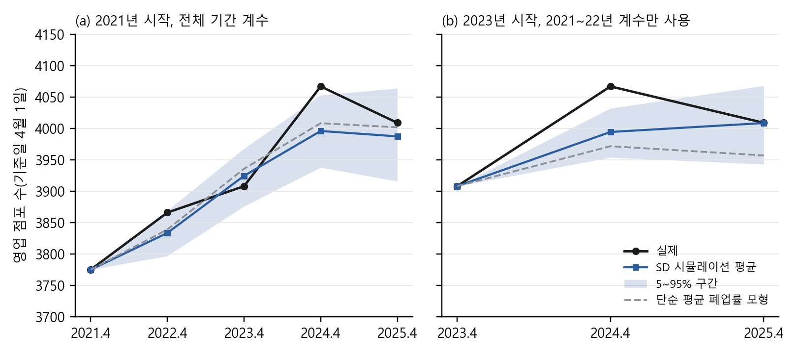
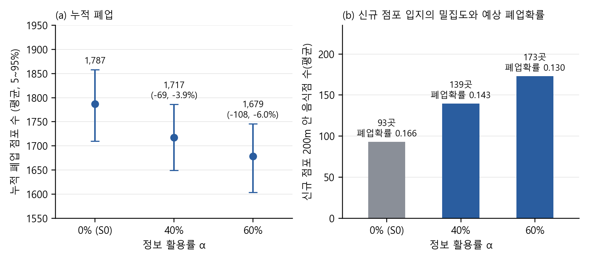

# 성동구 F&B 점포 생존 분석: 경쟁 네트워크 · Cox · System Dynamics

서울시 성동구 일반음식점이 **주변에 어떤 가게가 얼마나 있을 때 더 빨리 문을 닫는지**를 분석하고,
그 결과를 점포 수 시뮬레이션(System Dynamics)에 넣어 **신규 사업자가 입지 정보를 활용하면 폐업이 얼마나 줄어드는지**를 시나리오로 비교하는 연구의 코드·데이터·결과입니다.

- 보고서: 「경쟁 네트워크 구조를 반영한 서울시 성동구 음식점 폐업 위험 분석과 신규 입지 정보 활용 시나리오 시뮬레이션」(김은혜·오은준, 지도교수 오주희)
- 이 README만 읽어도 무엇을, 어떤 데이터로, 어떤 순서로 분석했고 결과 파일이 어디 있는지 알 수 있도록 정리했습니다.

## 목차

1. [한눈에 보기](#한눈에-보기)
2. [용어](#용어)
3. [진행 현황](#진행-현황-2026-10-19-기준)
4. [연구 설계](#연구-설계)
5. [주요 결과](#주요-결과)
6. [Cox 결과가 두 가지인 이유](#cox-결과가-두-가지인-이유)
7. [실행 방법](#실행-방법)
8. [폴더 구성](#폴더-구성)
9. [변수 설명](#변수-설명-datafinal_dataset_with_reviewscsv)
10. [결과 파일](#결과-파일)
11. [데이터 출처](#데이터-출처)
12. [한계와 참고](#한계와-참고)

## 한눈에 보기

분석은 세 덩어리이고, 코드 번호(1~9단계) 순서대로 이어집니다.

| 분석 | 무엇을 하나 | 표본 | 코드 | 결과 |
|---|---|---|---|---|
| **① 기준 Cox** (본 분석) | 2021-04-01에 영업 중이던 점포를 2026-10-13까지 추적해, 반경 100~500m 안 경쟁·집적·네트워크 구조가 폐업 위험과 어떤 관계인지 추정 | 3,775곳 (Cox는 매출 결측 제외 2,967곳) | 1~4단계 | `outputs/results_summary.md`, `outputs/tables/`, `outputs/figures/` |
| **② 연도별 Cox** | 같은 모형을 기준일 2021~2025년 4월 1일 코호트 5개에 각각 적용해 결과가 시점에 따라 달라지는지 확인 (보고서 표 1) | 3,775~4,067곳 × 5개 | 6~7단계 | `outputs/yearly/yearly_cox_summary.csv` |
| **③ SD 시뮬레이션** | 점포별 폐업 확률 → 점포 수(stock) 시뮬레이션. 2021→2025 실제 점포 수 재현(검증) 후, 신규 점포가 입지 정보를 활용하는 비율(α)별 시나리오 비교 (보고서 표 2·3, 그림 1·2) | 코호트 5개의 점포-연 19,625건 | 8~9단계 | `outputs/yearly/sd_*.csv`, `fig*.png`, `sd_run_log.txt` |

핵심 결과
- **집적(전체 음식점 수)은 일관되게 폐업 위험을 낮춥니다.** 100m 안 음식점이 10곳 많을수록 폐업 위험 약 6~9% 감소(모든 기준일·분석에서 유의).
- **동종 경쟁(같은 업태 수)의 효과는 시점에 따라 다릅니다.** 2021~2022년 코호트에서는 유의하지 않고, 2023~2024년 코호트에서는 위험을 높이는 방향(HR 1.10~1.13).
- **네트워크 지표의 추가 설명력은 일부 반경·시점에서만 유의**합니다.
- **SD**는 점포 수를 ±2% 안에서 재현했지만 단순 평균 폐업률 모형보다 낫다고 보기는 어렵습니다. 신규 점포의 40%·60%가 위험 정보를 활용하면 누적 폐업이 3.9%·6.0% 줄어드는데, 이는 **가정에 의존하는 탐색적 결과**입니다.

## 용어

| 용어 | 뜻 |
|---|---|
| 코호트 | 기준일(예: 2021-04-01)에 영업 중인 점포 집합. 이 점포들을 관찰 종료일까지 추적합니다. |
| 사건(event) / 중도절단 | 관찰 종료일(2026-10-13)까지 폐업하면 사건(1), 아직 영업 중이면 중도절단(0) |
| Cox 비례위험모형 | 폐업까지 걸린 시간을 설명하는 생존분석 모형. 결과는 위험비(HR)로 읽습니다. |
| HR (위험비) | 1보다 작으면 폐업 위험 감소, 크면 증가. 예: 10곳당 HR 0.93 → 10곳 많을수록 위험 7% 감소 |
| C (Competitor_C) | 반경 r 안 **같은 업태** 점포 수 (동종 경쟁) |
| BIZ (Adjacent_BIZ) | 반경 r 안 **업태와 무관한 전체** 음식점 수 (집적) |
| R (Competitor_R) | 같은 업태 비율 = C / BIZ |
| 경쟁 네트워크 | 점포를 점, 반경 r 안 같은 업태 점포 쌍을 선으로 이은 그물. 연결강도·매개중심성·군집계수를 계산 |
| System Dynamics (SD) | 쌓이는 양(stock: 점포 수)과 흐름(flow: 신규·폐업)으로 시스템 변화를 시뮬레이션하는 방법 |
| 정보 활용률 α | 신규 사업자 중 모형이 추정한 폐업 위험 정보를 보고 입지를 고르는 비율(시나리오 가정) |

## 진행 현황 (2026-10-19 기준)

| 단계 | 내용 | 상태 |
|---|---|---|
| 데이터 구축 | 인허가·상권·매출·임대료 결합, 네이버 리뷰 매칭 | 완료 |
| 경쟁·네트워크 변수 | 반경 100·200·300·500m C / BIZ / R, 연결강도·매개중심성·군집계수 | 완료 |
| 기준 Cox (①) | Kaplan-Meier, 반경별 Cox(H1–H3), 네트워크 Cox(H4), 강건성 검토 | 완료 |
| 비례위험 보완 | Competitor_R 시간가변 계수 모형 | 완료 |
| 연도별 Cox (②) | 기준일 2021~2025년 코호트 5개 | 완료 |
| SD 시뮬레이션 (③) | 점포-연 위험 함수 → stock-flow, 검증 2종, 정보 활용률 시나리오 | 완료 |
| 리뷰 평판 SD (5단계) | 리뷰 점수를 진입·폐업과 연결하는 동 단위 SD | **보류** (아래 참고) |
| 남은 일 | 아래 목록 | 진행 전 |

남은 일
1. **보고서용 Cox 사양 하나로 정하기.** ①과 ②의 매출 결측 처리 방식이 다릅니다([Cox 결과가 두 가지인 이유](#cox-결과가-두-가지인-이유)). 보고서 표 1·SD는 ②의 사양(전체 점포 + 매출 결측 더미)입니다.
2. **6단계를 저장소만으로 재실행 가능하게 하기.** 추정매출-상권 2022~2025년 원자료가 저장소에 없습니다(용량). `data/raw/`에 넣으면 6단계가 실행됩니다([6단계 준비](#6단계-준비-연도별-코호트를-다시-만들-때만)).
3. **SD 보완:** 입지 선택 규칙(후보 수, 선택 기준)의 민감도, 밀집지 혼잡 효과, 월 단위 구조.
4. **시나리오 확장(보고서 5장 계획):** 폐업 자리를 대체하는 업종(무인·배달), 유동인구 감소, LLM 기반 리뷰 서비스 품질 점수.
5. 코로나 기간 상호작용 분석(이전 계획, 미착수).

리뷰 평판 SD(5단계)를 보류한 이유: 리뷰 점수는 2026년 10월에 **영업 중인 점포에서만** 수집되어 과거(2021~2025) 시뮬레이션에 쓰면 시점이 맞지 않고, SD 시나리오의 대상인 신규 점포(2021 코호트 밖 1,591곳)에는 점수가 하나도 없습니다. 또 현재 점수(`review_quality_score_0_100`)는 리뷰가 적을수록 50점 쪽으로 당기는 보정 때문에 리뷰 수와 거의 같은 순서를 가집니다(순위상관 0.87). 코드와 결과(`code/05_sd_review_scenarios.py`, `outputs/sd/`)는 기록으로 남겨 두었습니다.

## 연구 설계

- **기준 집단**: 2021-04-01(2021년 1분기 말) 영업 중인 성동구 일반음식점 **3,775개**
- **관찰 기간**: 2021-04-01 ~ 2026-10-13(인허가 데이터 추출일), 폐업 **1,677개(44.4%)**, 나머지는 우측 중도절단
- **Cox 분석 표본(①)**: 상권 매출이 결측인 808곳(업종 미분류 780곳 포함)을 제외한 **2,967개**(폐업 1,267개)
- **연도별 코호트(②③)**: 2021~2025년 매년 4월 1일 기준, 3,775 / 3,866 / 3,908 / 4,067 / 4,009곳, 같은 종료일까지 추적
- **연구 질문**
  - RQ1. 반경 기반 경쟁 변수를 통제한 뒤에도 경쟁 네트워크 구조가 폐업 위험을 추가로 설명하는가?
  - RQ2. 경쟁 범위(반경·상권 정의)는 어떻게 정해야 폐업 위험을 가장 잘 설명하는가?
  - RQ3. 추정한 생존 요인을 SD 모형에 넣으면 정책 시나리오별 상권은 어떻게 변하는가?
- **가설**
  - H1 (동종 경쟁): 같은 업태 이웃 수(C)와 비율(R)이 클수록 폐업 위험이 높다.
  - H2 (집적): 전체 음식점 수(BIZ)가 클수록 폐업 위험이 낮다.
  - H3 (공간 범위): H1·H2의 효과는 반경이 작을수록 크다.
  - H4 (네트워크): 반경 변수를 통제한 뒤에도 네트워크 지표가 폐업 위험을 추가로 설명한다.

## 주요 결과

### ① 기준 Cox (2021 코호트, 1~4단계)

모든 Cox 모형은 업력, 임대료 수준(low/mid/high), 상권 점포당 매출(log), 업태 더미를 통제했고,
상권 단위 군집 강건 표준오차(72개 군집)를 사용했습니다. 전체 수치는 [`outputs/results_summary.md`](outputs/results_summary.md)에 있습니다.

| 가설 | 결과 | 근거 |
|---|---|---|
| H1 동종 경쟁 | 기각 | C·R 모두 네 반경에서 5% 수준으로 유의하지 않음 (C의 HR은 1 미만, 200·300m에서 p < .10) |
| H2 집적 | 지지 | 100m 안 음식점이 10곳 많을수록 폐업 위험 7.9% 감소 (HR 0.921, 95% CI 0.899–0.944) |
| H3 공간 범위 | 대체로 지지 | 표준편차 1 증가당 BIZ의 HR이 100·200m 0.77·0.76 → 500m 0.84로 약해짐 |
| H4 네트워크 | 부분 지지 | 100m(LR χ²(3) = 18.2, p < .001)와 200m(10.0, p = .019)에서 네트워크 지표의 증분 설명력이 유의. 가까운 동종 경쟁자에 촘촘히 둘러싸일수록(연결강도 1 SD당 HR 1.31, 200m 1.17) 폐업 위험 증가 |

- 반경 200m 음식점 수 상위 1/3 집단의 관찰 종료 시점 생존율은 64.6%로, 하위 1/3(49.2%)보다 15.4%p 높습니다(log-rank p < .001, 전체 3,775곳).
- 결론은 임대료 처리 방식(범주형·연속형·동 고정효과), 매출 변수 제외(매출 결측 점포 포함 전체 3,775곳), 주변 음식점 수 상위 5% 점포 제외, 일괄 폐업일 제외, 표준오차 보정 방식에 관계없이 유지됩니다.
- 인허가 좌표는 건물(지번) 단위라 같은 건물의 점포는 좌표가 같습니다(683개 지점에 2,137곳). 왕십리역 일대에서는 반경 200m 안 음식점이 최대 319곳으로 잡히는데, 대형 상가·지하 식당가처럼 한 건물에 수십 곳이 등록된 경우가 포함되기 때문입니다.
- 비례위험 가정: Adjacent_BIZ와 Competitor_C는 위반 없음(최소 p = .365, .073). Competitor_R은 200·300·500m에서 위반 신호(p = .013–.032)가 있어, R의 계수를 관찰 1년 구간마다 따로 추정하는 시간가변 계수 모형으로 보완했습니다. R의 HR은 초기 1.00–1.06에서 4~5년차 0.91–0.98로 조금씩 낮아지지만 어느 구간에서도 5% 수준으로 유의하지 않고, 구간 간 차이도 유의하지 않습니다(Wald p = .054–.219). 따라서 "동종 비율은 폐업 위험과 관련이 없다"는 결론은 같고, BIZ의 HR도 그대로입니다(`outputs/results_summary.md` 6절).

<p align="center">
  
  
</p>

### ② 연도별 Cox (보고서 표 1, 6~7단계)

반경 100m, 10곳 증가당 HR. 통제 변수와 군집 SE는 ①과 같고, 매출 결측 점포를 **포함**합니다(중앙값 대입 + 결측 더미). 반경 100~500m 전체는 `outputs/yearly/yearly_cox_summary.csv`.

| 기준일 | 점포 | 폐업 | 동종 C HR (p) | 전체 BIZ HR (p) | 네트워크 추가 LR p |
|---|---|---|---|---|---|
| 2021-04-01 | 3,775 | 1,677 | 0.983 (.659) | 0.933 (<.001) | .013 |
| 2022-04-01 | 3,866 | 1,535 | 1.023 (.604) | 0.930 (<.001) | .266 |
| 2023-04-01 | 3,908 | 1,269 | 1.104 (.035) | 0.919 (<.001) | .269 |
| 2024-04-01 | 4,067 | 1,066 | 1.133 (.045) | 0.913 (<.001) | .476 |
| 2025-04-01 | 4,009 | 660 | 1.118 (.081) | 0.937 (.002) | .364 |

- 집적(BIZ)의 보호 효과는 모든 기준일에서 유의하고, 반경이 커질수록 약해집니다.
- 동종 수(C)는 2023~2024년 코호트에서만 위험을 높이는 방향으로 유의합니다. 코호트들이 같은 점포를 공유하고 2025년 코호트는 추적이 약 1.5년뿐이라, 이 변화를 시간 추세로 단정할 수는 없습니다.

### ③ SD 시뮬레이션 (보고서 표 2·3, 8~9단계)

**모형** (연 단위, 매년 4월 1일에 한 걸음)

```
S(t+1) = S(t) − D(t) + E(t)                 S: 영업 점포 수, D: 폐업, E: 신규
D(t)   = Σ pᵢ(t),  pᵢ(t) = 1 − exp(−exp(ηᵢ(t)))       점포별 1년 폐업 확률 (비례위험의 이산시간 형태)
ηᵢ(t)  = a + 업력(log) + log 매출 + 매출결측 + 임대료 수준 + 업태 + β_C·C₂₀₀(t)/10 + β_B·BIZ₂₀₀(t)/10
```

- C₂₀₀, BIZ₂₀₀은 그해 영업 중인 점포로 **매년 다시 셉니다.** 그래서 신규·폐업이 밀도를 바꾸고, 밀도가 다음 해 폐업 확률을 바꾸는 피드백이 생깁니다.
- 계수는 5개 코호트의 점포-연 19,625건(폐업 2,238건)에서 추정했습니다(점포 단위 군집 SE, `outputs/yearly/sd_params.csv`). BIZ₂₀₀ 10곳당 HR 0.970(p < .001), C₂₀₀ 1.024(p = .10), 업력(log) 0.770.
- 신규 E는 실제로 다음 기준일에 영업 중이던 신규 점포를 그대로 넣습니다(외생). 시뮬레이션마다 계수를 추정 분포에서 뽑고 폐업은 확률적으로 생성합니다(200회).

**검증** (표 2): 점포 수를 모든 기준일에서 ±2% 안으로 재현했지만, 학습 기간 평균 폐업률만 쓰는 단순 모형과 오차가 비슷합니다. 점포 수는 실제 신규 점포를 넣는 영향이 커서 **밀도 피드백이 예측을 개선했다고는 말할 수 없습니다.** 연도별 폐업도 시뮬레이션은 435~459건으로 평탄한 반면 실제는 362~508건이라 연도 충격은 반영하지 못합니다.

| 구분 | 기준일 | 실제 | SD | 오차 | 단순 모형 오차 |
|---|---|---|---|---|---|
| (a) 2021 시작, 전체 기간 계수 | 2022-04 | 3,866 | 3,834 | −0.8% | −0.7% |
| | 2023-04 | 3,908 | 3,924 | +0.4% | +0.7% |
| | 2024-04 | 4,067 | 3,996 | −1.7% | −1.4% |
| | 2025-04 | 4,009 | 3,987 | −0.5% | −0.2% |
| (b) 2023 시작, 2021~22 계수만 | 2024-04 | 4,067 | 3,994 | −1.8% | −2.3% |
| | 2025-04 | 4,009 | 4,009 | 0.0% | −1.3% |

**정보 활용률 시나리오** (표 3): 정보를 받은 신규 사업자(비율 α)는 무작위 후보지 5곳과 원래 입지의 예상 폐업 확률을 비교해 가장 낮은 곳으로 옮깁니다. α=0이 기준(S0). **α와 선택 규칙은 가정이지 추정값이 아닙니다.**

| α | 누적 폐업 2021→2025 (5~95%) | S0 대비 | 신규 점포 폐업 | 2025 점포 수 | 신규 점포 주변 200m 음식점 수 |
|---|---|---|---|---|---|
| 0% (S0) | 1,787 (1,710~1,858) | — | 257 | 3,987 | 93 |
| 40% | 1,717 (1,649~1,786) | −69 (−3.9%) | 222 | 4,057 | 139 |
| 60% | 1,679 (1,604~1,746) | −108 (−6.0%) | 201 | 4,095 | 173 |

정보를 받은 신규 점포는 **밀집 지역으로 이동**합니다. 추정된 위험식에서 BIZ의 보호 효과가 C의 위험 증가보다 커서 붐빌수록 위험이 낮게 계산되기 때문입니다. 밀집지 혼잡·수요 분산·후보지 용량은 반영하지 않았으므로 −6%는 낙관적인 값으로 읽어야 합니다.

<p align="center">
  
  
</p>

## Cox 결과가 두 가지인 이유

①(4단계)과 ②③(6~8단계)은 같은 변수 정의를 쓰지만 두 가지가 다릅니다. 2021 코호트끼리 비교해도 숫자가 조금 다른 이유입니다(예: 100m BIZ HR ① 0.927 vs ② 0.933).

| 항목 | ① 기준 Cox (`code/04_cox_analysis.py`) | ② 연도별 Cox·③ SD (`code/yearly_cox_spec.py`, `08_sd_simulation.py`) |
|---|---|---|
| 매출 결측 808곳 | Cox 표본에서 **제외** (n = 2,967) | log 매출을 중앙값으로 채우고 **결측 더미**를 넣어 전체 사용 (n = 3,775) |
| 2021 코호트 좌표·상권·매출 | 현재 1단계 결과(10월 인허가 갱신 반영) | 2026-09-12 기준 1단계 결과의 사본(`data/interim/yearly_snapshot_20260912/`) |

- 사양 차이: ②③을 만들 당시(10/15) 4단계는 결측 더미 방식이었고, 그 뒤 4단계가 결측 제외 방식으로 바뀌었습니다. 연도별 결과를 그대로 재현할 수 있도록 당시 코드를 `code/yearly_cox_spec.py`로 보존했습니다.
- 좌표 차이: 10월 인허가 파일에서 점포 10곳의 좌표가 수정되었습니다. ①은 수정된 좌표, ②③은 이전 좌표를 써서 이 점포들과 그 이웃의 경쟁 변수가 대부분 ±1 정도 다릅니다(200m 동종 수 235곳, 전체 음식점 수 446곳). 사건·관찰 기간은 같습니다.
- 보고서에 어느 쪽을 쓸지는 [남은 일 1](#진행-현황-2026-10-19-기준)에서 정합니다. 한쪽으로 맞추면 다른 쪽을 다시 실행해야 합니다.

## 실행 방법

프로젝트 폴더(이 README가 있는 곳)에서 스크립트를 번호 순서대로 실행합니다. 각 스크립트는 파일 위치를 기준으로 경로를 찾으므로 어느 폴더에서 실행해도 됩니다. Python 3.9 이상.

```bash
pip install -r requirements.txt

# ① 기준 Cox
python code/01_preprocess.py       # 원자료 → data/interim/final_restaurant_level_dataset.csv   (약 1분)
python code/02_attach_reviews.py   # + 리뷰 요약 변수 → data/interim/restaurants_with_reviews_raw.csv
python code/03_build_features.py   # + 경쟁·네트워크 변수 → data/final_dataset_with_reviews.csv (약 10초)
python code/04_cox_analysis.py     # 생존분석 → outputs/results_summary.md, tables/, figures/  (약 30초)
python code/05_sd_review_scenarios.py  # (보류) 리뷰 평판 시나리오 SD → outputs/sd/

# ② 연도별 Cox · ③ SD
python code/06_yearly_cohorts.py   # 코호트 5개 → data/yearly/   ※ 추정매출 2022~2025 필요(아래), 결과는 이미 저장소에 있음
python code/07_yearly_cox.py       # → outputs/yearly/yearly_cox_summary.csv                     (약 2분)
python code/08_sd_simulation.py all > outputs/yearly/sd_run_log.txt   # → sd_params / sd_backtest / sd_scenarios.csv (검증 약 10분, 시나리오 30분 이상)
python code/09_sd_figures.py       # → outputs/yearly/figA_sd_validation.png, figB_sd_scenarios.png
```

| 단계 | 정상 실행 확인 |
|---|---|
| 1 | `최종 데이터 shape: (3775, 33)` |
| 1 | `인허가 데이터 최종수정일: 2026-10-13 \| 관찰 종료일: 2026-10-13` |
| 2 | `리뷰 매칭 1,395개 (37.0%)` |
| 3 | `저장: data/final_dataset_with_reviews.csv (3,775행 × 51열)` |
| 4 | `Cox 표본 2,967개 (매출 결측 808곳 제외, 폐업 1,267건, 군집 72개)` |
| 6 | `[2] 좌표 지오코딩 캐시로 채움 294곳`, `마스터 5878곳 ... 좌표 없음 8 → 제외`, 코호트별 `n=3775, 폐업 1677` … `n=4009, 폐업 660` |
| 7 | 마지막 표(연결강도 p)의 2021행이 `0.018 0.195 0.616 0.027` |
| 8 | `[추정] 점포-연 19625건, 폐업 2238건 \| C200 10곳당 HR 1.024 ...` (전체 출력은 `outputs/yearly/sd_run_log.txt`와 같아야 함) |

- 7·8·9단계는 저장소에 있는 코호트 파일(`data/yearly/`)만으로 실행됩니다. 2026-10-19에 다시 실행해 7단계(`yearly_cox_summary.csv`, 최대 차이 2×10⁻⁷)와 8단계의 계수·검증(`sd_params.csv`, `sd_backtest.csv`, 차이 10⁻¹² 이하)이 저장소 결과와 같은 것을 확인했습니다. 8단계 시나리오(`sd_scenarios.csv`)는 시간이 오래 걸려 다시 돌리지 않았습니다(같은 코드·시드).
- 시간을 줄이려면 `python code/08_sd_simulation.py backtest`(계수·검증만) 또는 `scenario`(시나리오만)로 나눠 실행합니다.
- 8단계는 난수 시드가 고정되어 있어 같은 결과가 나옵니다. 빠르게 확인만 하려면 `NREP=20 python code/08_sd_simulation.py all`(결과 수치는 달라짐). `scenario`만 실행해도 계수 추정은 매번 다시 합니다.
- 인허가 파일을 새로 내려받으면 `code/01_preprocess.py`의 `STUDY_END_DATE`와 `code/04_cox_analysis.py`의 `STUDY_END`를 그 파일의 추출일(최종수정일자 최댓값)로 바꿉니다. 1단계가 두 날짜가 다르면 경고합니다.
- 좌표가 없는 점포의 Kakao 지오코딩 결과는 `data/interim/geocode_cache.csv`에 저장되어 있어 API 키 없이 실행됩니다. 캐시에 없는 9개 점포(지오코딩 실패)는 좌표 결측으로 제외됩니다. 다시 지오코딩하려면 `export KAKAO_REST_API_KEY="..."` 후 실행합니다.
- `code/01_preprocess.py`의 `PAPER_VERSION = True`는 보고서와 같은 전처리 설정입니다. 보고서 분석 당시 업태 매핑표에는 5개 업태(통닭(치킨), 외국음식전문점, 식육(숯불구이), 김밥(도시락), 탕류(보신용); 194곳)가 없었고, 상권 매출은 공식 상권 밖 점포에도 IDW로 보간했습니다. `False`로 바꾸면 최신 매핑표를 쓰고 상권 밖 점포는 보간하지 않습니다(결과 수치가 달라짐).

### 6단계 준비 (연도별 코호트를 다시 만들 때만)

6단계는 기준 연도마다 상권 점포당 매출을 다시 계산하므로 **추정매출-상권 2022~2025년** 파일이 필요합니다. 용량이 커서 저장소에 넣지 않았습니다.

1. 서울 열린데이터광장에서 「서울시 상권분석서비스(추정매출-상권)」 2022, 2023, 2024, 2025년 CSV를 내려받습니다.
2. 파일 이름을 `서울시_상권분석서비스(추정매출-상권)_{연도}년.csv`(또는 `.csv.zip`)로 맞춰 `data/raw/`에 넣습니다.
3. `python code/06_yearly_cohorts.py` → `data/yearly/cohort_*.csv`가 다시 만들어집니다.

- 저장소 결과와 같은 코호트를 만들려면 위 원자료와 `data/raw/성동구_일반음식점_인허가_갱신_20261019.csv`(2026-10-19 내려받음)를 그대로 써야 합니다. 인허가 파일을 새로 받으면 폐업·신규 점포가 달라집니다.
- `END=2026-09-12 python code/06_yearly_cohorts.py`로 실행하면 2021 코호트가 9/12 기준 3단계 결과(`data/interim/yearly_snapshot_20260912/final_dataset_with_reviews.csv`)와 일치하는지 검증합니다(경쟁·네트워크 변수·업종 코드·임대료 수준·상권 100% 일치, 상권 매출 89.5% 일치 — 어긋난 곳은 공식 상권 밖 점포의 보간값이라 2021 코호트는 사본 값을 그대로 씀).

## 폴더 구성

```
code/
  01_preprocess.py           1단계: 인허가·상권·매출·임대료 원자료 → 점포 단위 데이터
  02_attach_reviews.py       2단계: 네이버 리뷰 요약 변수 결합
  03_build_features.py       3단계: 열 이름 정리, 임대료 범주, 반경 경쟁 변수, 경쟁 네트워크 변수
  04_cox_analysis.py         4단계: Kaplan-Meier, Cox 모형(반경·네트워크), 강건성 검토, 그림·표·요약
  05_sd_review_scenarios.py  5단계(보류): 리뷰 평판 점수를 시나리오 변수로 쓰는 동 단위 SD
  06_yearly_cohorts.py       6단계: 기준일 2021~2025 코호트 5개 구축 (3단계 변수 정의 사용)
  07_yearly_cox.py           7단계: 코호트별 Cox (보고서 표 1)
  08_sd_simulation.py        8단계: SD 추정·검증·정보 활용률 시나리오 (보고서 표 2·3)
  09_sd_figures.py           9단계: SD 그림 2개 (보고서 그림 1·2)
  yearly_cox_spec.py         7단계가 쓰는 Cox 모형 정의 (4단계의 10/15 버전 보존본, 매출 결측 더미 방식)
  review_collection/         네이버 리뷰 수집 기록 (분석 실행에는 필요 없음)
    naver_crawling_cohort.py   영업 점포를 한 곳씩 네이버 지도에서 검색 → 주소 검증 → 리뷰 수집
    combine_parts.py           나눠서 수집한 part 파일 합치기
    review_merge.py            리뷰 → 점포별 요약 변수 (review_features.csv의 원천)
data/
  raw/                       원자료 (대부분 zip으로 압축, 코드가 그대로 읽음)
    서울시 성동구 일반음식점 인허가 정보.csv        1단계용, 2026-10-13 추출
    성동구_일반음식점_인허가_갱신_20261019.csv      6단계용, 2026-10-19 내려받음
    서울시_상권분석서비스(점포-상권)_2021~2025년      2022~2025는 6단계용(2025년 파일은 영문 열 이름)
    서울시_상권분석서비스(추정매출-상권)_2021년       2022~2025는 저장소에 없음(6단계 준비 참고)
  interim/
    geocode_cache.csv                   Kakao 지오코딩 결과 캐시 (1단계 입력)
    review_features.csv                 리뷰 요약 변수, 1,395개 점포 (2단계 입력)
    naver_match_results.csv             인허가 점포 ↔ 네이버 매장 매칭 기록
    restaurant_review_scores.csv        리뷰 품질 점수 (5단계 입력, 보류)
    final_restaurant_level_dataset.csv  1단계 결과
    restaurants_with_reviews_raw.csv    2단계 결과
    yearly_snapshot_20260912/           6단계 입력: 9/12 기준 2·3단계 결과 사본 + VWorld 지오코딩 캐시
  final_dataset_with_reviews.csv        3단계 결과: 분석용 최종 데이터 (3,775행 × 51열)
  yearly/cohort_{2021~2025}_end20261013.csv   6단계 결과: 연도별 코호트 (7·8단계 입력)
outputs/
  results_summary.md         ① 전체 결과 요약
  tables/  figures/          ① 결과 표·그림
  yearly/                    ②③ 결과 (표·그림·실행 로그)
  sd/                        5단계(보류) 결과
requirements.txt
```

## 변수 설명 (`data/final_dataset_with_reviews.csv`)

`data/yearly/cohort_*.csv`도 같은 열 이름을 쓰며(리뷰 열 없음), 값은 각 기준일 기준입니다.

| 구분 | 변수 | 설명 |
|---|---|---|
| 식별 | `restaurant_id` | 인허가 관리번호 |
| | `store_name`, `address_jibun`, `longitude`, `latitude` | 상호명, 지번주소, 좌표(WGS84) |
| | `license_date`, `closure_date` | 인허가일, 폐업일 |
| 업태 | `category_code`, `category_name` | 서울시 서비스 업종 코드·이름 (8개). 결측 780곳은 분석에서 '미분류' |
| 상권 | `trdar_code`, `trdar_name` | 서울시 공식 상권 코드·이름 (상권 밖 점포는 결측) |
| | `area_sales_per_store` | 기준 연도 1분기 상권×업종 점포당 추정매출(원). 결측 808곳(①에서는 Cox 표본에서 제외, ②③에서는 결측 더미) |
| 임대료 | `dong`, `rent_median` | 법정동, 동별 평당전세가 중위값 (2021Q1, 모든 코호트에 고정) |
| | `rent_level` | 임대료 수준 low(<1,700) / mid(1,700–2,900) / high(≥2,900). 동 하나가 두 단계에 걸치지 않도록 동 값 사이의 큰 간격을 경계로 설정 |
| 생존 | `event` | 1 = 관찰 기간 중 폐업, 0 = 중도절단 |
| | `duration_days`, `observation_end` | 기준일부터 폐업일 또는 관찰 종료일까지의 일수, 그 종료일 |
| | `business_age_years` | 기준일 시점 업력(년) |
| 반경 경쟁 | `competitor_c_{r}m` | 반경 r m 안 같은 업태 이웃 수 (Competitor_C) |
| (r = 100, 200, 300, 500) | `adjacent_biz_{r}m` | 반경 r m 안 전체 음식점 수 (Adjacent_BIZ) |
| | `competitor_r_{r}m` | 같은 업태 비율 C / BIZ (Competitor_R) |
| 경쟁 네트워크 | `net_strength_{r}m` | 가중 연결강도: 같은 업태 이웃의 Σ(100 / 거리m). 100m 이웃 1곳 = 1 |
| | `net_betweenness_{r}m` | 매개중심성(정규화): 거리를 길이로 둔 최단경로 기준 |
| | `net_clustering_{r}m` | 군집계수: 같은 업태 이웃끼리도 서로 이웃인 비율 |
| 리뷰 (영업 점포만) | `naver_place_id`, `review_match_status`, `review_shared_place`, `has_review` | 네이버 매장 ID, 매칭 상태, 한 매장에 인허가 여러 건 여부, 리뷰 매칭 여부 |
| | `review_volume` | log(1 + 방문자 리뷰 총수): 온라인 노출도·수요 규모 |
| | `review_segment`, `review_tagged_n` | 성동구 평균 대비 특히 많은 손님층, 손님층 태그가 있는 리뷰 수 |
| | `review_revisit_share` | 재방문 리뷰 비율: 고객 충성도 |

변수 계산 기준
- 이웃은 기준일에 영업 중인 표본 점포이며, 자기 자신은 제외합니다.
- 거리는 EPSG:5186 평면좌표로 계산합니다.
- 경쟁 네트워크는 점포를 노드로, 반경 r 안의 같은 업태 점포 쌍을 엣지로 둡니다. 같은 건물(0m) 쌍은 거리를 10m로 봅니다. 업종 코드가 없는 점포는 '미분류'를 하나의 업태로 봅니다.
- 원자료의 `rent_mean`, `duration_months`, `restaurants_all_300m`, `competitors_same_300m`은 최종 데이터에서 제외했습니다. 300m 변수는 위 기준으로 반경 4개 모두 다시 계산했습니다.

## 결과 파일

### ① 기준 Cox (`outputs/`)

| 파일 | 내용 |
|---|---|
| `results_summary.md` | 전체 결과 요약 |
| `tables/variable_summary.csv` | 주요 변수 기술통계 |
| `tables/km_by_adjacent_biz_200m.csv` | 200m 음식점 수 3분위별 생존율, log-rank 검정 |
| `tables/cox_radius_models.csv` | 반경 × 모형(A: C+BIZ, B: R+BIZ)별 HR, 95% CI, p, C-index, 비례위험 검정 p, 1 SD당 HR |
| `tables/cox_full_300m_model_b.csv` | 300m 모형 B 전체 계수 (통제 변수 포함) |
| `tables/cox_network_models.csv` | 모형 C(모형 A + 네트워크 지표)의 HR, VIF, 우도비 검정, AIC, C-index |
| `tables/cox_robustness_300m.csv` | 강건성 검토 7가지 설정 |
| `tables/cox_time_varying_r.csv` | 비례위험 가정 보완: Competitor_R의 관찰 1년 구간별 HR, 구간 동일성 Wald 검정 |
| `figures/fig_km_by_adjacent_biz_200m.png` | Kaplan-Meier 생존곡선 |
| `figures/fig_forest_competition_by_radius.png` | 반경별 경쟁 변수 HR (1 SD당) |

HR 단위: C·BIZ는 10곳, R은 10%p, 네트워크 지표는 표준편차 1(매개중심성은 log 변환 후) 증가당입니다.

### ② 연도별 Cox · ③ SD (`outputs/yearly/`)

| 파일 | 내용 |
|---|---|
| `yearly_cox_summary.csv` | 코호트(`cohort`) × 반경(`radius_m`) × 모형(`model` A·B·C)별 HR, 95% CI, p, C-index, 1 SD당 HR. `table = network` 행은 모형 C와 우도비 검정(`lr_chi2`, `lr_p`), VIF, AIC |
| `sd_params.csv` | SD 폐업 확률식 계수(`coef`), HR, p. `C200`·`BIZ200`은 10곳 단위, `log_age`는 log(1+업력), `ls`는 log 매출, `sm`은 매출 결측, `mid`·`high`는 임대료 수준, `c_*`는 업태(기준 한식) |
| `sd_backtest.csv` | 검증 시뮬레이션 회차(`rep`) × 연도별 영업 점포 수(`stock_before`, `stock_after`), 폐업 수, 신규 점포 수·폐업·평균 예상 폐업확률(`ent_p`)·주변 음식점 수(`ent_biz`). `name`이 검증 (a)/(b) |
| `sd_scenarios.csv` | 정보 활용률 `alpha`(0, 0.4, 0.6) × 회차 × 연도별 같은 항목 |
| `sd_run_log.txt` | 8단계 콘솔 출력(표 2·3의 요약 수치) |
| `figA_sd_validation.png` | 그림 1: 점포 수 검증 (실제 / SD 평균·5~95% / 단순 모형) |
| `figB_sd_scenarios.png` | 그림 2: (a) α별 누적 폐업, (b) 신규 점포 입지의 밀집도와 예상 폐업확률 |

## 데이터 출처

| 구분 | 자료 | 출처 |
|---|---|---|
| 생존(종속) | 성동구 일반음식점 인허가 정보 (2026-10-13 추출: 1단계 / 2026-10-19 내려받음: 6단계) | 서울 열린데이터광장 |
| 상권·매출 | 상권분석서비스 상권영역·점포-상권·추정매출-상권 (각 연도 1분기) | 서울 열린데이터광장 |
| 임대료 | 성동구 상가임대료 (2021Q1) | 성동구 |
| 업태 매핑 | 인허가 업태 → 서울시 서비스 업종 매핑표 | 직접 작성 |
| 좌표 보완 | Kakao Local API (1단계), VWorld 지오코딩 (6단계 새 점포) | Kakao, 국토교통부 VWorld |
| 리뷰 | 네이버 지도 플레이스 방문자 리뷰 | 직접 수집 (2026.10) |

## 한계와 참고

- **SD 시나리오는 가정에 의존합니다.** 정보를 받은 사업자가 모형이 추정한 위험을 정확히 안다고 가정했고, 집적의 보호 효과가 입지 자체의 좋음을 대신 나타내는 것이라면 밀집지로 옮기는 실제 효과는 훨씬 작을 수 있습니다. 신규 flow는 외생이고 연 단위 4단계입니다.
- 임대료는 2021년 1분기 값을 모든 코호트에 고정했습니다(2021-11 이후 자료 없음).
- 6단계 좌표는 1단계와 같이 인허가 X,Y를 EPSG:5174로 보고 변환했습니다. 이 방식은 실제 위치와 약 313m 어긋날 가능성이 있습니다. 점포 간 거리에는 영향이 없지만 상권(shp) 배정에는 영향이 있을 수 있습니다. 6단계에서 좌표를 끝내 찾지 못한 새 점포 8곳은 제외했습니다.
- 업태→업종코드 매핑은 6단계에서 2021 코호트 값으로 복원했습니다(15개 업태). 매핑이 없는 업태(기타, 통닭(치킨) 등)는 미분류입니다.
- 하루 20곳 이상이 폐업 처리된 날이 4번(2022-09-13, 2022-11-29, 2022-12-15, 2025-03-12; 총 190곳) 있어 행정상 일괄 정리로 보고, 이 점포들을 제외한 강건성 검토를 ①에 함께 제시합니다.
- 리뷰 변수는 관찰 종료 시점의 영업 점포에만 있으므로 생존 모형에는 넣지 않습니다. 리뷰 수집 대상은 9월 12일 인허가 기준 영업 점포 2,119곳이었고, 관찰 종료 시점(10월 13일) 영업 점포 2,098곳 중 2,097곳이 이 대상에 포함됩니다(1곳은 10월 자료에서 폐업 취소). 이 중 1,389곳(66.2%)이 네이버 리뷰와 매칭되었으며, 수집 대상 중 10월 13일까지 폐업한 22곳(리뷰 매칭 6곳)은 폐업으로 처리됩니다.
- 상권 매출은 상권×업종 매출이 직접 관측되지 않은 971곳(상권 밖 688곳 포함) 중 943곳을 1km 이내 동일 업종 상권 매출의 역거리가중(IDW) 보간으로 채웠고(`data/interim/final_restaurant_level_dataset.csv`의 `sales_source`), 업종 미분류 780곳과 보간 불가 28곳은 결측입니다.
- 코호트 파일과 최종 데이터에는 점포명·지번주소가 들어 있습니다(공개 인허가 자료). 저장소를 공개로 바꿀 때는 이 점을 고려하세요.

### 변경 이력

| 날짜 | 변경 |
|---|---|
| 2026-10-16 | 관찰 종료일 2026-09-12 → 2026-10-13 (10월 인허가, 폐업 1,656 → 1,677: 신규 폐업 22곳, 폐업 취소 1곳). ①에서 매출 결측 808곳을 중앙값 대입 + 결측 더미 → Cox 표본 제외(n = 2,967)로 변경. 인허가 정보 갱신으로 점포 10곳의 상호·좌표가 수정되어 경쟁 변수 일부가 ±1~2 달라짐 |
| 2026-10-17 | 5단계 리뷰 평판 SD 추가(이후 보류) |
| 2026-10-19 | ② 연도별 Cox, ③ SD 시뮬레이션 코드·데이터·결과 추가(6~9단계). 5단계 보류 |
